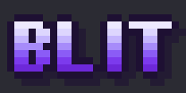
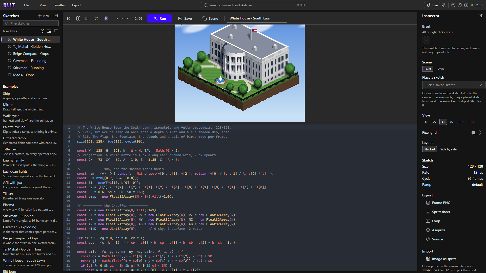
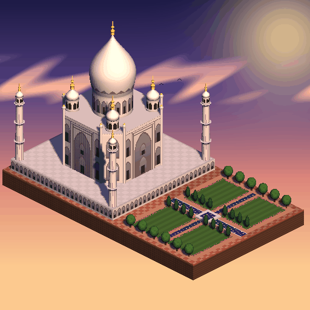
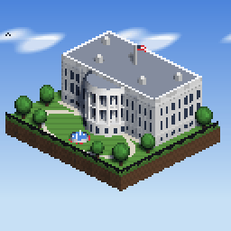
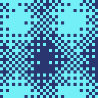
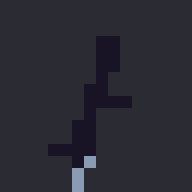
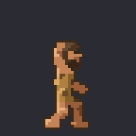
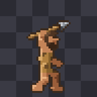
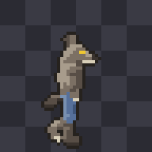
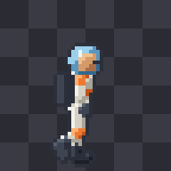

# Blit



A live-coding REPL for pixel art and sprite animation. Strudel's model, applied
to a raster canvas: you type a pattern, press Ctrl+Enter, and the canvas swaps to
it without stopping.

Blit is not a replacement for a pixel editor. It goes after the three things a
GUI is structurally bad at:

1. **Families.** One parameterised sprite, forty consistent variants.
2. **Timing.** Editing an animation while it plays, which is the only place live
   coding genuinely beats clicking.
3. **Rule-based work.** Auto-tiling, dithered ramps, "outline everything one
   pixel in a darker shade": an afternoon in a GUI, one operator here.

And because code is a terrible brush, **clicking a pixel on the canvas edits the
character that drew it**, through any chain of mirrors, offsets and rotations.



## Gallery

All made in Blit, from a few lines of code to a few hundred.

| | | |
|:-:|:-:|:-:|
| <br>Taj Mahal, 512×512 iso | <br>White House, 128×128 iso | <br>Plasma, a raw `fn()` |
| <br>Stickman, running | <br>Caveman, exploding | <br>Caveman, spear throw |
| <br>Wolf, walk cycle | <br>Spaceman, walk cycle | <br>The Blit logo |

## The model

One type carries the entire language:

```
Pattern = (x, y, ctx) => Color
```

`ctx` is the frame's context and `t` is `ctx.frame`, the absolute frame counter,
handed to your `fn()` callbacks directly because it is the field you want nearly
every time. A hand-drawn sprite literal is one constructor of that type. A
generated field is another. Because they are the same type they compose with the
same operators, so a dithered procedural gradient can sit behind a sprite you
drew by hand without leaving the algebra.

Four things the pattern cannot know about itself come from the render context:
the canvas size (so `mirror` and `jux` have an axis), the frame clock and cycle
length (so the time operators work), the live palette (so `.pal()` is an ordinary
combinator rather than a rebuild), and what the music is doing this frame.

### Characters are the mini-notation

Strudel's terseness comes from `"0 1 [2 3]"`. Pixel art already invented its
equivalent, and has been sharing sprites in it for thirty years:

```js
sprite(`
  ...ww...
  ..wwww..
  .wwccww.
  wwwwwwww
  ..w..w..
`).pal({ w: '#c0cbdc', c: '#41a6f6' })
```

`.` and a space are transparent. Letters are mnemonic by default (`k` black,
`w` white, `r` red, `g` green, `b` blue, and so on). Digits `0` to `9` index the
active **ramp** rather than a fixed color, which is what makes palette cycling
free.

### Time is cycles of frames

`cycle(n)` sets how many frames make a cycle, and every time operator is defined
against it. That is why Strudel's `fast`, `slow`, `every`, `seq` and `euclid` port
across with no redesign.

## Running it

Blit is a self-contained Node.js app: an Express server with a SQLite file for
storage, serving a React client. Node 20.11 or later.

```bash
npm install
npm run build      # build the client into dist/
npm start          # http://127.0.0.1:3000
```

| Variable  | Default        | Meaning                                    |
|-----------|----------------|--------------------------------------------|
| `PORT`    | `3000`         | Port to listen on                          |
| `HOST`    | `127.0.0.1`    | Interface to bind; `0.0.0.0` for the LAN   |
| `BLIT_DB` | `data/blit.db` | SQLite file; created and migrated on start |

There are no accounts and no permissions: everyone who can reach the port shares
one library of sketches. Put it behind your own auth if it is exposed.

## Getting started

Open the app in a browser. It loads with a sketch running. Then:

- **Ctrl+Enter** (Cmd+Enter on a Mac) evaluates the buffer. Nothing runs on a
  keystroke: you compose an edit, then commit it.
- The toolbar shows `edited` while the buffer has moved past what is on the
  canvas. That is a state, not an error.
- **Unsaved text is kept in the browser** as a per-sketch draft and restored on
  the next load, with a bar saying so and a Discard to go back. It is a crash net,
  not a save: it never leaves the browser.
- **`Space`** plays and pauses; **`.`** and **`,`** step a frame forward and back.
  The command bar also carries a scrub along the cycle and a `slot / cycle`
  readout. Anything that seeks pauses first.
- **`Ctrl`/`Cmd` + `S`** saves, from anywhere on the page including the name
  field. `Ctrl`/`Cmd` + `Enter` runs.
- **Click the canvas** to paint the selected character into the sprite that drew
  that pixel. Alt or right click erases. Pick the character in the Brush section
  of the right panel.
- **`text('HELLO')`** draws words in a built-in pixel font, as an ordinary
  pattern: outline it, tint it, centre it, animate it.
- **Drag the handle between the canvas and the editor** to resize them, and
  choose whether they are stacked or side by side in the right panel's View
  section. Both are remembered.
- **A picture bigger than the stage scrolls**, edge to edge, in every
  arrangement and at any split, and a zoom keeps the middle of the view put
  rather than dropping you in the sprite's top-left corner.
- **Zoom** is in the same View section, and it is saved WITH THE SKETCH rather
  than with the browser: a sketch opens at the zoom it was last saved at, and a
  new one opens at 2x. Save, or `Ctrl`/`Cmd` + `S`, writes it along with the
  text — a 128x128 import and a 16x16 icon are not looked at from the same
  distance, so one browser-wide setting would be wrong for one of them.
- The frame counter survives a re-evaluation, so an edit refines the animation
  instead of restarting it.
- A sketch runs on its own as soon as it is evaluated, unless the viewer's system
  asks for reduced motion, in which case it opens paused on frame 0 and Play is
  theirs to press.

Sketches are compiled in strict mode, so an undeclared assignment is reported as
an error rather than silently setting a property on the browser window.

Blit's chrome is the **Fluent 2** design system (`@fluentui/react-components`
v9). Fluent components colour the command bar, the panels, the workbench card and
the drawer, in light and dark, following the OS setting (`?theme=light` or
`?theme=dark` pins one). The violet brand is declared once in
`client/lib/blitTheme.ts` and applied by the `<FluentProvider>` in
`client/pages/BlitPage.tsx`; colour and elevation come from the theme's
`tokens.*` through Griffel, not a hand-authored skin. The code keeps
its own editor theme. `client/lib/blitIdentity.test.ts` holds that boundary.

Load an example from the left panel and change it. The examples are the
documentation: each one teaches exactly one idea.

Full operator reference: [docs/language.md](docs/language.md). The editor surface,
the keyboard map and what changes on a touch screen: [docs/interface.md](docs/interface.md).

## Sketch shape

A sketch is JavaScript. Either form works:

```js
// A bare expression IS the sketch.
sprite(`.ww.`).mirror('x').scale(4).center()
```

```js
// Or statements, with an explicit sink.
size(32, 32); fps(12); cycle(8);
const ship = sprite(`...`).pal({ w: '#fff' });
out(ship.shadow(1, 1).outline('#181425'));
```

`out()` wins if both a sink and a return value are present, so a sketch that
grows from one form into the other keeps working mid-edit.

Settings live in the code (`size`, `fps`, `cycle`, `ramp`), never in a control
panel. The right panel shows them read-only: a widget that could silently
disagree with the source would give the same fact two homes.

Zoom is the exception that proves the rule. It is not in that list because a
sketch cannot declare how closely you are standing to it, so it has no home in
the code at all — which is why it is the one view setting stored on the sketch
row and saved with the sketch.

## Click-to-paint, and what it can reach

Each `sprite(...)` template literal in the source is located and tagged before
evaluation, so the pattern it builds can report which cell produced a pixel.
Resolving a click is two passes:

1. Which sprite cell drew the pixel you can see.
2. If nothing did, which sprite's footprint the pixel falls inside. That is how
   clicking a hole in a sprite, or just outside its outline, paints there and
   grows the shape.

This survives arbitrary transform chains because the transform operators only
move coordinates: provenance rides along untouched, and `stack` is the single
place that has to arbitrate between competing layers.

Two limits are worth knowing:

- A literal that interpolates (`` sprite(`${row}`) ``) still renders but is not
  clickable. Its characters no longer sit at fixed offsets, so an edit could not
  be placed safely.
- A sprite built from a runtime string (`sprite(art)`) is likewise not clickable.
- When one literal is used by several calls (the Enemy family example), painting
  edits the shared template, so every variant changes. That is the intent.

## Scenes

A sketch can place other saved sketches: `blit('Coin', 40, 32)` draws the sketch
called Coin with its top-left corner at (40, 32), running in its own canvas, on
its own clock and palette. A 512x512 level can be made of 32x32 pieces that are
each still their own sketch — edit the coin once and every scene that places it
changes.

```js
size(512, 512);
out(scene(
  checker('#1a1c2c', '#262b44', 32),
  blit('Coin', 40, 32),
  blit('Hero', 240, 400),
));
```

It works in code, and by hand. **Scene** in the command bar switches the canvas
from painting characters to arranging placed sketches: click one to pick it,
drag it to move it, nudge it with the arrow keys. **Place a sketch** in the
right panel, or dragging a row from the sketch list onto the canvas, adds one.
Every one of those is an edit to the source — the call's numbers, or a new
call — so the scene stays a sketch somebody can read and keep writing.

The placed sketches are fetched from your own list as a scene asks for them, and
resolved by name (or id, for a name two sketches share). A sketch that places
itself, directly or through another, is refused rather than drawn forever. Reference: [docs/language.md](docs/language.md),
Scenes; [docs/interface.md](docs/interface.md), Scene mode.

## Text

`text()` is a constructor like `sprite()` or `circle()`, so a word is a pattern
and every operator applies to it. Two built-in fonts, because the canvas is
small: `3x5` is caps-only and fits eight characters across the default 32px
canvas, which is the one that can actually label a sprite; `5x7` has real
lowercase, real descenders and every printable ASCII character.

The advance is the ink rather than the cell — `I` takes one pixel and `M` takes
five — so the box `text()` reports is the word's own and `.center()` centres the
letters instead of a rectangle.

```js
out(stack(
  text('BLIT', '#ffcd75').outline('#181425').center(),
  text('score 0', { font: '5x7' }).shift(1, 1),
));
```

It is not a sprite literal: text pixels have no home in the source, so clicking
one paints nothing, the same as `grad()` or `noise()`. Drawing the letters as
grids is still there if you want a pixel to be clickable.

## Reacting to music

A sketch can be a function of what is playing. `ctx.audio` carries both halves of
that: the analyser's view of the signal (`bass`, `mid`, `treble`, `vol`, the raw
bins) and the events actually sounding right now, each with its sound name, note,
gain and the cycle it began on. Plus the transport position and whether it is
running.

Events rather than pixels is the design, not a shortcut. A toolkit built on
shaders would hand a sketch the other program's rendered image, because filtering
an image is what a shader does. Blit composes its own pixels out of an algebra,
so note names and gains are what a sprite can be a function of; a picture of a
waveform is not.

One construct makes a number reactive, and it exists because of how a sketch
runs. The body runs once per **edit**, not once per frame, so anything read at
the top level is sampled when you press Ctrl+Enter and never again. `live()`
moves the read inside the frame, where it is re-read by construction rather than
by you remembering:

```js
out(live((a) => solid(grey(a.bass * 255))));
```

That costs one rebuild per frame however many pixels there are. `.onBeat()` is
the same idea for the discrete half: `.onBeat((p) => p.scale(2), 0.15)` applies a
transform on an onset and for a sixth of a second after it. Seconds rather than
frames, because a sketch runs at its own `fps()` while the music does not.

The music is **silence** unless something supplies it (this app has no audio
source of its own; `ctx.audio` is the hook for one): every level zero, no
events, one frozen shared value. That is what makes this an addition rather than
a migration. Every sketch saved before it existed renders byte for byte what it
rendered before, in the editor, in the spritesheet and in every export, and the
gallery is asserted against a loud frame to keep it that way.


## Export

- **Frame PNG**: the frame on screen, at its native size.
- **Spritesheet**: one cycle laid out left to right in a single PNG.
- **Loop**: one cycle as an animated GIF, at the zoom you are working at. The
  spritesheet is the right thing to hand an engine; this is the one to show a
  person.
- **Aseprite**: the cycle as an `.aseprite` sprite — frames, timing and palette
  intact — for somebody who wants to keep drawing.
- **Source**: the sketch itself, which is the real document.

All five run in the browser. The pattern is already there, and a round trip to
the server would only add a way for two renderers to disagree.

The loop is a GIF so it plays everywhere: chat apps, image viewers, issue
trackers. GIF has 256-colour tables and one bit of alpha, so a frame with up to
255 colours exports exactly; past that (`grad`, `noise`, a dithered plasma) the
colours are median-cut down to 255. Pixels under half alpha export transparent,
the rest opaque.

Loops encode one frame at a time, so even 256 frames at 512x512 export at full
natural size. Export zoom reduces automatically for large loops; the sprite
and cycle are never shortened. Each frame gets its own palette, and the browser
can handle input between frames.

### Aseprite

A spritesheet is what you hand an engine and a GIF is what you show a person.
The third audience is the pixel artist who wants to keep working, and for them a
strip to slice by hand is a worse artifact than either. The `.aseprite` export
opens as a real sprite: one frame per frame of the cycle, each carrying the
sketch's own timing, on one named layer, tagged as the loop it is.

**Indexed when it fits, RGBA when it does not.** Blit is a palette language —
characters map to colours, digits index a ramp, `.palShift()` cycles one — and a
six-colour sprite handed over as 32-bit RGBA would arrive having thrown away the
one structure the artist most wants. So the colours are counted first: up to 256
distinct ones and the file is Indexed, with the sketch's exact colours as the
sprite's palette and index 0 reserved for transparent. Past that, it is RGBA,
because quantising the sketch would mean the export did not look like what
it exported, and Aseprite's
own RGB-to-Indexed conversion is one menu item away and better than anything
that belongs in here.

Neither mode is lossy. An indexed file carries the exact RGBA of every colour,
partial alpha included, in its palette.

**Always at natural size**, unlike the loop. Zoom is a way of looking at a
sketch, and baking it into a file meant for a pixel editor would hand over a 4x
bitmap with no way back to the grid worth editing.

## Import

Drop a PNG on the canvas, or use the Import section of the right panel. What you
get back is **source**: a `sprite()` grid and the `.pal()` binding its
characters, which is then ordinary code.

That is the line. Blit is not a pixel editor, and an importer that produced an
opaque bitmap layer would be trying to make it one. Emitting code makes an
existing sprite into something the language can work on, which is the opposite
move: a hand-drawn 16x16 becomes a family, a walk cycle, a dithered variant.

A file may be **up to 1024x1024**; a grid stops at 128x128, because a sprite
literal is one character per pixel. Two numbers on purpose: art is shared at a
multiple of the size it was drawn at, so the 32x32 arrives as a 512x512. Anything
over 128 gets a size picked for it in a bar above the editor, each choice showing
the grid it makes and how many colours that grid would have. The resize runs on
the server and is nearest-neighbour only: every other filter averages, and an
average of two colours is a third colour that was in no pixel of the file. So a
whole-number upscale comes back as the sprite somebody drew, byte for byte.

No colour is approximated, so the import is exact and the remaining limits are
refusals rather than fudges: PNG only, and up to 35 colours. PNG only because the
bytes are decoded directly instead of through a canvas, which stores colour
premultiplied and cannot return a half-transparent pixel unchanged.

## Folders

Saved sketches live in a tree of folders, nested as deep as you like, drawn in
the left panel with a chevron and a
folder icon per folder with how many sketches it holds, folders before sketches
at every level, and a filter box, a sort (last edited, or by name) and New
folder / Collapse all above it.

- **Make a folder** with the New folder button (it lands inside the folder with
  focus, or at the top) or from a folder's menu, and name it in place. Two
  folders side by side cannot share a name, case aside; a clash is said under
  the name being typed rather than in a toast that leaves.
- **File a sketch** by dragging it onto a folder, onto any row in one, or onto
  the "Move to the top level" strip that appears while dragging; or with
  **Move to** in its menu. Folders move the same way, with everything in them.
  A closed folder held under a drag opens. Nothing lights up as a target that
  the server would refuse, like a folder dropped into itself.
- **New sketch here** on a folder's menu starts a sketch that is filed there
  when it is first saved.
- **Rename** with F2, a double-click on a sketch, or the menu. **Delete** with the
  Delete key or the menu: a folder's delete asks first and keeps everything that
  was in it, one level up. No folder operation ever deletes a sketch.
- The menu opens on a right-click, on Shift+F10, and from each row's "…" button,
  which is always visible on a touch screen.

Moving a sketch is not editing it: its `updated_at` stays put, so filing
something away does not jump it to the top of the recent-first order. Which
folders are open and the sort are remembered per browser.

## Storage and scope

Sketches live in one SQLite database: id, name, source, zoom, the folder they are
filed in, and timestamps. Folders are a name and a parent. Nothing else is
persisted.

**Sketch code runs on the server in exactly one place, and only in a sandbox.**
Evaluation and rendering happen in the browser, on code the person typed, except
`POST /api/blit/render`, which renders a sketch to a PNG for scripts and tools.
That route runs the sketch in a separate Node process with an empty environment,
Node's permission model on (no file access, no child processes, no workers), a
256MB heap and a time limit, evaluating inside a `vm` context whose global has a
null prototype and which only strings cross. See `server/lib/renderSandbox.ts`.

`POST /api/blit/lint` reads sketch source too, and parsing is not running: no
server module imports the evaluator (the render route carries it only as a
bundled string for the sandbox), and the scope a sketch compiles against lives in
`client/lib/blit/api.ts` precisely so the lint can name it without being able to
reach the evaluator. `POST /api/blit/import` goes the other way and *writes*
source, from pixels; it neither parses nor runs what it emits.

## API

`/api/blit/status`, CRUD on `/api/blit/sketches`, `PUT
/api/blit/sketches/{id}/folder` to file one, CRUD on `/api/blit/folders`,
`PATCH /api/blit/sketches/{id}/edit` for exact find/replace inside one,
`/api/blit/lint` to check a sketch without running it, `/api/blit/render` to get
a PNG of one (up to sixteen frames as a contact sheet), and `/api/blit/import` to
turn a base64 PNG into sprite source. Every JSON answer is `{ success, data }` or
`{ success: false, error }`. Reference: [`openapi.json`](openapi.json).

## MCP server

`mcp/server.ts` lets an agent work in Blit over the Model Context Protocol. It is
a thin client over the API above, so it needs Blit running (`npm run dev`), and
it talks to `BLIT_URL` (default `http://127.0.0.1:3000`).

| Tool | Does |
|---|---|
| `blit_list_sketches` | List saved sketches. |
| `blit_get_sketch` | Read one, with its code. |
| `blit_create_sketch` | Save a new one. |
| `blit_update_sketch` | Rename, replace the code, or apply find/replace `edits` (linted on the way). |
| `blit_delete_sketch` | Delete one. |
| `blit_lint` | Check source without saving or running it. |
| `blit_render_png` | Render a saved sketch or a draft to a PNG, up to 16 frames as a sheet. |

Claude Code picks it up from the repo's `.mcp.json`. Any other client runs
`npx tsx mcp/server.ts` (or `npm run mcp`) over stdio.

## Development

```bash
npm run dev        # API on :3000 (tsx watch) + Vite client with HMR on :5173
npm run typecheck  # tsc, strict
npm test           # vitest: engine, components and API routes
npm run runtime    # rebuild the server render sandbox's engine bundle
```

The engine under `client/lib/blit/` is pure TypeScript with no React or DOM
dependency, which is why it can be tested directly and is where the tests
concentrate. The server imports it too (lint, import, render), so after changing
anything under `client/lib/blit/` run `npm run runtime`; `npm test` and
`npm run build` fail while the bundled copy is stale.

```
client/   React app (pages, components) and the Blit engine (lib/blit)
server/   Express app, SQLite access, routes, migrations, render sandbox
docs/     language reference and editor/keyboard guide
```
